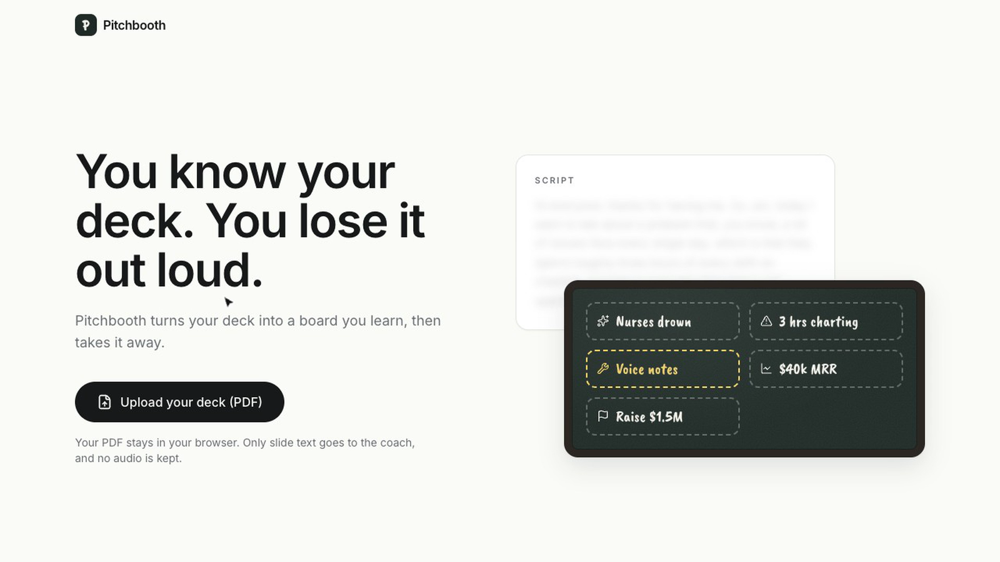
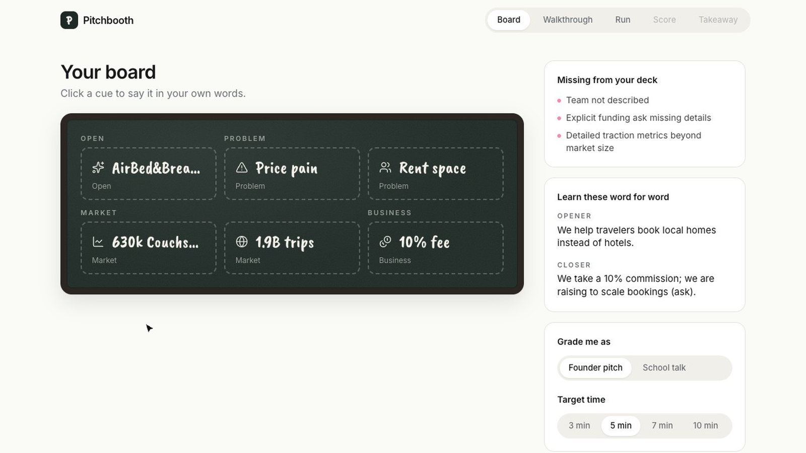
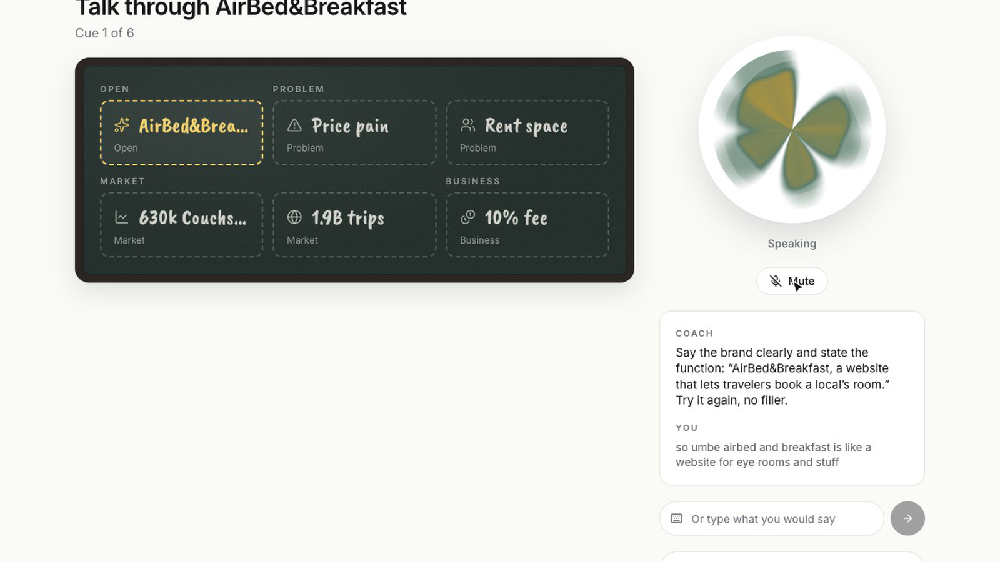
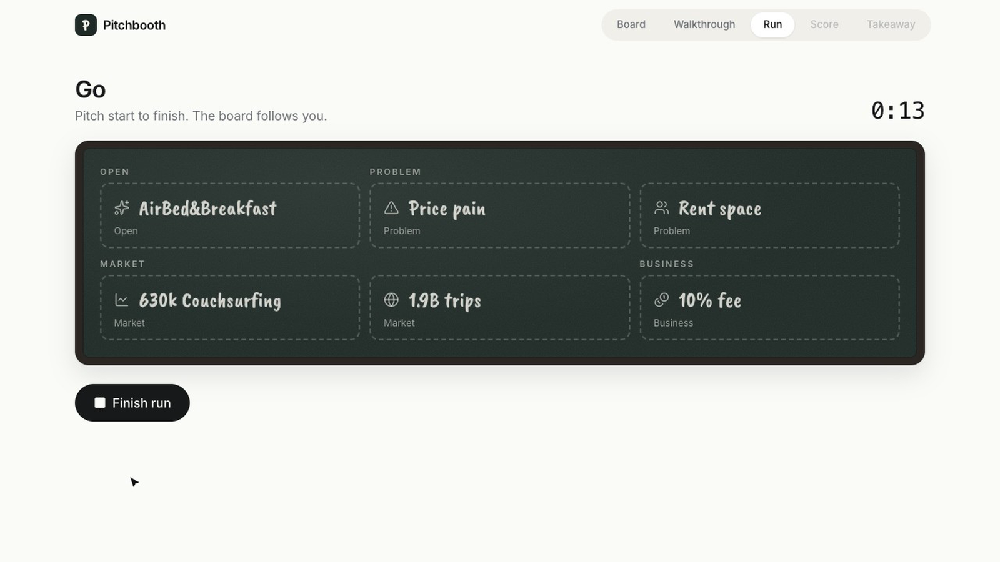
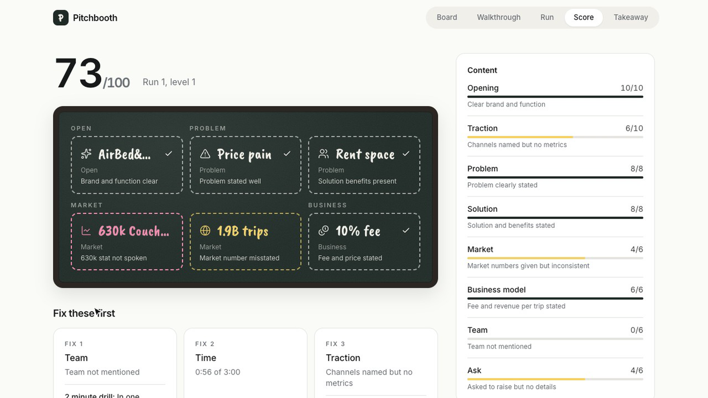
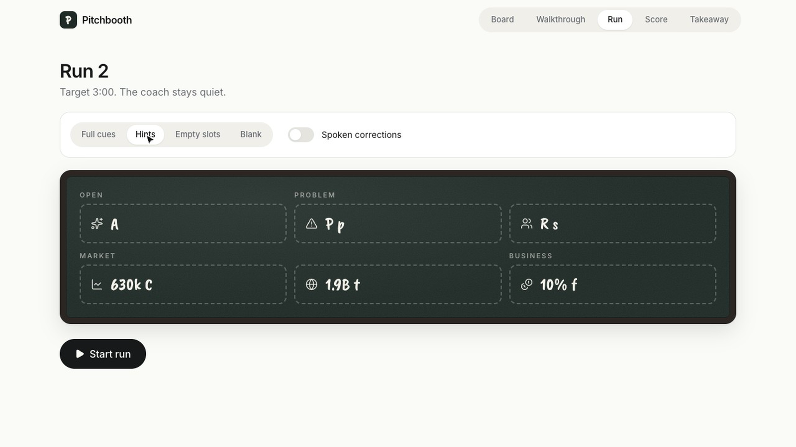
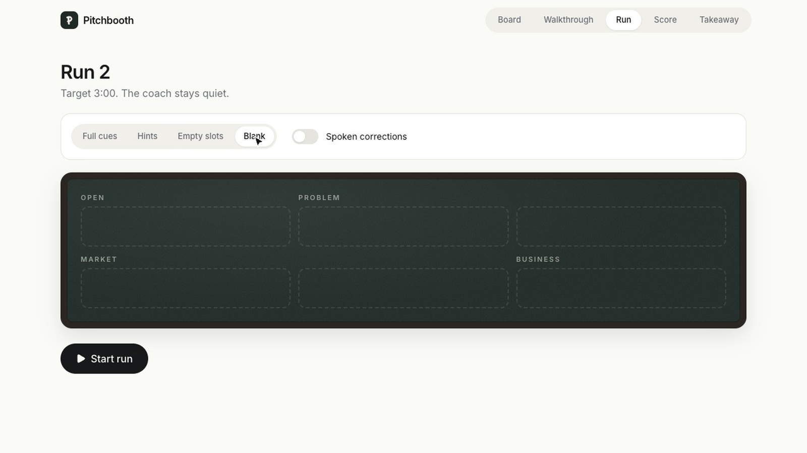
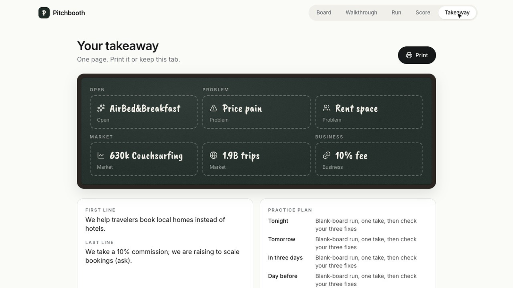

# Pitchbooth

You know your deck. Then you stand up to pitch and lose it.

Pitchbooth turns your PDF deck into one board of short memory cues, coaches you through it out loud, then hides the board a step at a time until you can pitch without it.

Live: https://pitchbooth.onrender.com

## How it works

1. Upload a PDF deck, up to 20 pages and 20 MB. It is read in your browser and only the slide text goes to the coach.
2. The coach writes 5 to 7 cues of 1 to 3 words in fixed spots, plus what investors will expect that the deck leaves out.
3. Walkthrough: say each section out loud. The coach answers by voice with one thing to fix.
4. Timed run: the coach stays quiet and the board follows where you are.
5. Every run gets a score out of 100 and the three fixes that matter most.
6. Each run shows less of the board: full cues, hints, empty slots, then blank.
7. Leave with a one-page takeaway you can print.

## Screenshots

Taken on the live site with the 2009 Airbnb pitch deck.

| | |
| --- | --- |
|  Landing |  Board built from the deck |
|  Coach replying out loud |  Timed run |
|  Score and fixes |  Run 2 with hints |
|  Blank board |  One-page takeaway |

## Stack

- Next.js and TypeScript
- eve agent on OpenAI `gpt-5-mini`, with only its own board and session tools
- AssemblyAI streaming speech to text
- Speechmatics voice for the coach
- Neatlogs traces for every coach turn and tool call
- Render web service with a persistent disk

## Run it

Set `OPENAI_API_KEY`, `ASSEMBLYAI_API_KEY`, `SPEECHMATICS_API_KEY` and `NEATLOGS_API_KEY`, then:

```bash
npm install
npm run dev
npm test
```

## Deploy

`render.yaml` is a Render Blueprint. Add the same four keys in Render.
